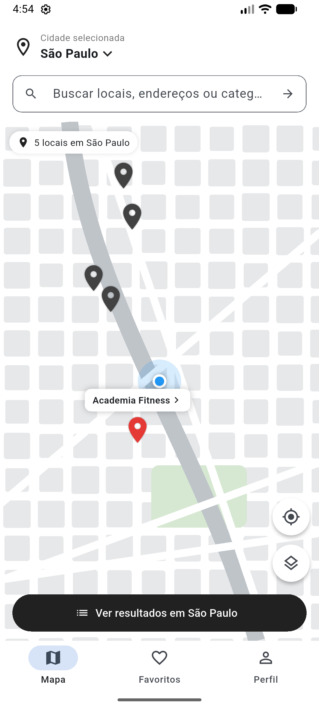
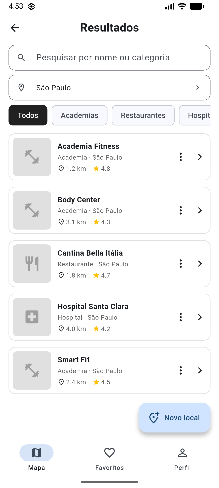
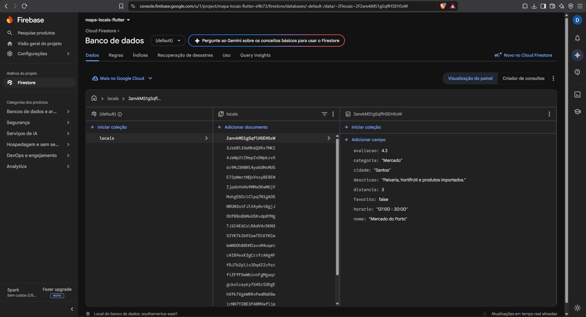

# Documentação — Mapa de Locais

**Avaliação formativa — Desenvolvimento de Aplicação Mobile com Flutter (SENAI)**

Aplicativo Flutter com três telas (mapa, resultados e detalhes) cujos dados ficam
no **Cloud Firestore**, configurado com **FlutterFire**.

| Item | Valor |
|---|---|
| Projeto Firebase | `mapa-locais-flutter-e9b73` |
| App Android registrado | `com.example.formativa_01` |
| Banco | Cloud Firestore, edição Standard, `(default)`, região `southamerica-east1` (São Paulo) |
| Coleção | `locais` — 21 documentos de exemplo |

## 1. Descrição da problemática

Uma empresa deseja disponibilizar um aplicativo que permita aos usuários localizar
serviços e estabelecimentos em diferentes cidades. O usuário precisa selecionar a
cidade, pesquisar o que procura, filtrar os resultados, abrir os detalhes de um
estabelecimento e marcar locais como favoritos. O sistema também deve permitir
cadastrar novos locais e alterar ou excluir os existentes.

## 2. Objetivo da aplicação

Desenvolver um aplicativo Android em Flutter com três telas (mapa, resultados e
detalhes) que permita consultar, cadastrar, editar, excluir e favoritar locais
armazenados na coleção `locais` do Cloud Firestore.

## 3. Requisitos funcionais

| Código | Requisito | Como foi atendido |
|---|---|---|
| RF01 | Selecionar cidade | Seletor no topo do mapa e filtro na tela de resultados: São Paulo, Campinas, Jundiaí e Santos. |
| RF02 | Pesquisar | Campo de pesquisa no mapa e nos resultados; busca por nome ou categoria, sem diferenciar maiúsculas e acentos. |
| RF03 | Consultar Firestore | `LocalService.listarLocais()` usa `collection('locais').snapshots()`; as telas se atualizam sozinhas quando o banco muda. |
| RF04 | Filtrar | Chips de categoria, filtro de cidade e filtro de favoritos. |
| RF05 | Cadastrar local | Botão **Novo local** abre um formulário (Bottom Sheet) e chama `adicionar()` → `add()`. |
| RF06 | Editar local | Menu ⋮ > **Editar** abre o mesmo formulário preenchido e chama `atualizar()` → `doc(id).update()`. |
| RF07 | Excluir local | Menu ⋮ > **Excluir** pede confirmação e chama `excluir()` → `doc(id).delete()`. |
| RF08 | Detalhes | A Tela 3 mostra todas as informações do documento. |
| RF09 | Favoritar | O coração na tela de detalhes chama `alterarFavorito()` → `doc(id).update({'favorito': ...})`. |
| RF10 | Navegação | Mapa → Resultados → Detalhes, botão voltar, barra inferior e "Ver no mapa". |

## 4. Requisitos não funcionais

- Desenvolvido em Flutter/Dart, com interface para Android.
- Banco de dados Cloud Firestore, configurado com FlutterFire (`lib/firebase_options.dart`).
- Código organizado em pastas (`models`, `services`, `screens`, `widgets`, `dialogs`, `utils`).
- Exclusão sempre pede confirmação.
- Toda operação no banco mostra mensagem de sucesso (verde) ou de erro (vermelho),
  com o motivo informado pelo Firestore (ex.: `permission-denied`).
- Lista vazia, pesquisa sem resultado e falha de leitura têm mensagens próprias.
- Se o Firebase não inicializar, o app mostra uma tela de erro em vez de fechar.
- Formulário com validação: campos obrigatórios, avaliação entre 0 e 5, distância
  não negativa e horário no formato `06:00 - 22:00` ou `24h`.
- Regras de segurança no Firestore validam todo documento gravado (seção 9).

## 5. Tecnologias utilizadas

| Tecnologia | Uso |
|---|---|
| Flutter 3.47 / Dart 3.13 | Interface e lógica |
| Firebase (`firebase_core`) | Backend; inicialização no `main.dart` |
| Cloud Firestore (`cloud_firestore`) | Banco de dados NoSQL — coleção `locais` |
| Firebase CLI + FlutterFire CLI | Ligação do app ao projeto Firebase |
| Material 3 | Componentes visuais |
| `StreamBuilder` | Telas atualizadas em tempo real pelo `snapshots()` |
| `CustomPainter` | Desenho do mapa |
| flutter_test + `fake_cloud_firestore` | Testes automatizados com Firestore falso em memória |

O mapa é uma **representação desenhada com `CustomPainter`** (o mapa real é
extensão opcional). Cada cidade tem um traçado próprio, cada local tem um
marcador, e o mapa aceita arrastar e dar zoom.

## 6. Arquitetura do projeto

```
lib/
├── main.dart                  Inicializa o Firebase e abre a tela de mapa
├── firebase_options.dart      Gerado pelo `flutterfire configure` (não editar)
├── models/
│   └── local.dart             Model Local (fromMap / toMap / copyWith)
├── services/
│   ├── local_service.dart     Única classe que acessa o Firestore
│   └── dados_exemplo.dart     21 locais de exemplo
├── screens/
│   ├── mapa_screen.dart       Tela 1 — Mapa principal
│   ├── resultados_screen.dart Tela 2 — Lista / resultados
│   └── detalhes_screen.dart   Tela 3 — Detalhes do local
├── widgets/
│   ├── local_card.dart        Item da lista
│   ├── local_form.dart        Formulário de cadastro/edição (Bottom Sheet)
│   ├── mapa_ilustrado.dart    Mapa desenhado + marcadores
│   ├── seletor_cidade.dart    Bottom Sheet de cidades
│   ├── barra_navegacao.dart   Barra inferior Mapa/Favoritos/Perfil
│   └── imagem_placeholder.dart
├── dialogs/
│   └── confirm_delete.dart    Confirmação de exclusão
└── utils/
    ├── constantes.dart        Cidades, categorias e ícones
    ├── filtros.dart           Pesquisa e filtros
    ├── horario.dart           Cálculo de "Aberto/Fechado"
    ├── validadores.dart       Validações do formulário
    ├── mensagens.dart         SnackBars de sucesso/erro
    └── mapa_destaque.dart     Posição dos marcadores e "Ver no mapa"
android/app/google-services.json  Gerado pelo `flutterfire configure`
firestore.rules                Regras de segurança do Firestore
firebase.json / .firebaserc    Projeto padrão e arquivo de regras do Firebase CLI
```

Fluxo em camadas: **telas → `LocalService` → Cloud Firestore**. As telas nunca
usam o pacote `cloud_firestore` diretamente: recebem um `Stream<List<Local>>`
do serviço e usam `StreamBuilder`. Como o `snapshots()` do Firestore avisa toda
mudança no banco, qualquer cadastro, edição ou exclusão aparece na hora em todas
as telas, inclusive se for feita pelo Firebase Console ou por outro aparelho.

A pesquisa e os filtros são aplicados em memória (`utils/filtros.dart`) sobre a
lista recebida do Firestore, como sugerido na seção 16 do tutorial.

## 7. Modelo da coleção `locais`

Cada documento da coleção tem um ID gerado automaticamente pelo Firestore e os
campos abaixo. O ID não é gravado como campo: o model o recebe de `doc.id`.

| Campo | Tipo no Firestore | Exemplo |
|---|---|---|
| nome | string | "Academia Fitness" |
| categoria | string | "Academia" |
| cidade | string | "São Paulo" |
| avaliacao | number (0 a 5) | 4.8 |
| distancia | number (km) | 1.2 |
| horario | string | "06:00 - 22:00" ou "24h" |
| descricao | string | "Academia completa com..." |
| favorito | boolean | false |

```
locais/
└── 8fK2x... (ID automático)
    ├── nome: "Academia Fitness"
    ├── categoria: "Academia"
    ├── cidade: "São Paulo"
    ├── avaliacao: 4.8
    ├── distancia: 1.2
    ├── horario: "06:00 - 22:00"
    ├── descricao: "Academia completa com musculação..."
    └── favorito: false
```

`Local.fromMap()` aceita documentos criados manualmente no Console: campos que
faltarem recebem valores padrão, e números inteiros (ex.: `5`) viram `double`.

## 8. Operações CRUD

| Operação | Método no `LocalService` | Comando no Firestore | Onde é usada |
|---|---|---|---|
| Create | `adicionar(local)` | `locais.add(local.toMap())` | Botão **Novo local** |
| Create | `cadastrarExemplos()` | `batch()` + `set()` para 21 documentos | Botão **Cadastrar dados de exemplo** (coleção vazia) |
| Read | `listarLocais()` | `locais.snapshots()` | Mapa e Resultados |
| Read | `observarLocal(id)` | `locais.doc(id).snapshots()` | Detalhes |
| Update | `atualizar(local)` | `locais.doc(id).update(local.toMap())` | Menu **Editar** |
| Update | `alterarFavorito(id, valor)` | `locais.doc(id).update({'favorito': valor})` | Coração nos detalhes |
| Delete | `excluir(id)` | `locais.doc(id).delete()` | Menu **Excluir** (após confirmação) |

Cada operação de gravação é chamada por `executarOperacao()` (`utils/mensagens.dart`),
que mostra a mensagem de sucesso ou, se o Firestore recusar a operação, a
mensagem de erro com o motivo. `update()` falha se o documento não existir mais
(ex.: excluído por outro aparelho), e esse erro também aparece na tela.

## 9. Regras de segurança

O banco foi criado em **modo de produção** (tudo bloqueado) e em seguida
recebeu as regras de [firestore.rules](../firestore.rules), publicadas com
`firebase deploy --only firestore:rules`. O Firebase CLI compila as regras antes
de publicar e recusa o envio se houver erro de sintaxe. Em nenhum momento o
banco ficou no "modo de teste", que deixa tudo aberto:

- Só a coleção `locais` pode ser acessada; qualquer outro caminho é negado.
- Leitura é liberada, porque o app mostra os locais a qualquer usuário.
- Criação e edição só são aceitas se o documento tiver **exatamente** os oito
  campos do model, com os tipos corretos e dentro dos limites (nome não vazio,
  avaliação entre 0 e 5, distância não negativa, textos com tamanho máximo).
  Campos extras ou valores inválidos são recusados com `permission-denied`.
- Como o app ainda não tem login, não é possível restringir a escrita a
  administradores. Isso exige Firebase Authentication (desafio extra nível 3):
  bastaria acrescentar `request.auth != null` às regras de gravação e exclusão.

As regras publicadas foram testadas contra o banco real com chamadas à API REST
do Firestore, sem login (como faria qualquer pessoa de fora do app):

| Operação | Esperado | Resultado |
|---|---|---|
| Criar local válido | permitido | 200 — permitido |
| Criar com campo extra (`hacker`) | negado | 403 — negado |
| Criar com avaliação 7 | negado | 403 — negado |
| Criar com nome vazio | negado | 403 — negado |
| Gravar em outra coleção | negado | 403 — negado |
| Alterar só `favorito` para `true` | permitido | 200 — permitido |
| Alterar `favorito` para o texto `"sim"` | negado | 403 — negado |
| Ler a coleção | permitido | 200 — permitido |
| Excluir o documento de teste | permitido | 200 — permitido |

## 10. Tabela de testes

### 10.1 Testes manuais (roteiro da avaliação)

Executados em 28/10/2026 no emulador Android (Medium Phone, API 37), com o app
ligado ao Firestore real. As gravações foram conferidas consultando o banco pela
API do Firestore.

| ID | Teste | Procedimento | Resultado |
|---|---|---|---|
| T01 | Conexão | Abrir o app e verificar que os marcadores e a lista mostram os documentos do Firestore. | Passou — "5 locais em São Paulo" no mapa |
| T02 | Pesquisa | Pesquisar "Academia". | Passou — Academia Fitness, Body Center e Smart Fit |
| T03 | Cidade | Selecionar Campinas no topo do mapa. | Passou — "6 locais em Campinas" |
| T04 | Filtro | Em Resultados, tocar no chip "Restaurantes". | Passou — só Restaurante Sabor Caseiro |
| T05 | Create | Tocar em **Novo local**, preencher e salvar; conferir o novo documento no Firestore. | Passou — "Padaria Teste T05" gravado (22 documentos) |
| T06 | Read | Fechar e reabrir a tela de resultados e verificar que o registro continua lá. | Passou |
| T07 | Update | Menu ⋮ > Editar; alterar nome ou horário e salvar; conferir no Firestore. | Passou — horário 07:00 - 19:00 → 08:00 - 18:00 no banco |
| T08 | Delete | Menu ⋮ > Excluir > confirmar; o item some da lista e do Firestore. | Passou — confirmação exibida; volta a 21 documentos |
| T09 | Favorito | Nos detalhes, tocar no coração para marcar e desmarcar; o campo `favorito` muda no Firestore. | Passou — Farmácia Vida marcada e desmarcada |
| T10 | Navegação | Abrir resultados, detalhes e voltar; testar "Ver no mapa". | Passou |
| T11 | Erro | (a) Pesquisar "xyz" → "Nenhum local encontrado". (b) Publicar temporariamente uma regra com `allow read: if false` → "Erro ao carregar os locais" com `permission-denied`. Depois, publicar de novo o `firestore.rules`. | Passou — (a) e (b); regras restauradas em seguida |

### 10.2 Testes automatizados (`flutter test`)

44 testes, todos passando. Os que envolvem banco usam `FakeFirebaseFirestore`,
um Firestore em memória com a mesma API do real; por isso rodam sem internet.

| Arquivo | O que verifica |
|---|---|
| `test/models/local_test.dart` | Conversão `fromMap`/`toMap`, valores padrão e `copyWith`. |
| `test/services/local_service_test.dart` | Leitura ordenada (T01), documento criado no Console, gravação dos exemplos, cadastro com ID automático (T05), atualização automática da lista, edição (T07), exclusão (T08), favorito (T09) e erro com documento inexistente (T11). |
| `test/screens/telas_firestore_test.dart` | Telas ligadas ao banco: contagem de locais no mapa, lista filtrada por cidade (T01/T03), botão de dados de exemplo, exclusão pela lista (T08), favorito nos detalhes (T09) e mensagem quando o Firestore recusa a operação (T11). |
| `test/utils/filtros_test.dart` | Pesquisa "Academia" (T02), cidade Campinas (T03), categoria (T04), favoritos, acentos e lista vazia. |
| `test/utils/horario_validadores_test.dart` | "Aberto/Fechado" (inclusive após meia-noite) e validações do formulário. |
| `test/widgets/widgets_test.dart` | Card da lista, menu editar/excluir, formulário (vazio, cadastro e edição) e diálogo de exclusão. |

As regras de segurança não são cobertas pelos testes automatizados: o Firestore
falso ainda não interpreta funções nem `request.resource`. Elas foram testadas
no banco real (tabela da seção 9).

### 10.3 Verificação no emulador com o Firebase real

Executado em 28/10/2026 no emulador Android (Medium Phone, API 37), com o app
ligado ao projeto `mapa-locais-flutter-e9b73`:

| Verificação | Resultado |
|---|---|
| App inicializa o Firebase e abre o mapa (sem tela de erro) | OK |
| Com a coleção vazia, mapa e resultados mostram "Nenhum local cadastrado" | OK |
| "Cadastrar dados de exemplo" grava 21 documentos (conferido pela API do Firestore) | OK |
| Resultados lista os locais de São Paulo lidos do Firestore | OK |
| Coração nos detalhes grava `favorito: true` no documento (conferido pela API) | OK |
| "Ver no mapa" volta ao mapa com 5 marcadores e o local destacado | OK |

## 11. Capturas das três telas

Capturadas no emulador com os dados vindos do Firestore.

| Tela 1 — Mapa | Tela 2 — Resultados | Tela 3 — Detalhes |
|---|---|---|
|  |  |  |

## 12. Print do Firestore

Firebase Console com a coleção `locais` (21 documentos) e os campos de um deles.



## 13. Limitações

- **Sem autenticação:** qualquer pessoa com o app pode cadastrar, editar e
  excluir. As regras impedem dados inválidos, mas não identificam o usuário.
- **Favorito global:** o campo `favorito` fica no documento, então é o mesmo
  para todos os usuários (favoritos por usuário é o desafio extra nível 5).
- **Filtros em memória:** o app baixa a coleção inteira e filtra no aparelho.
  Para muitos documentos, o ideal é usar `where()`/`orderBy()` (desafio nível 4).
- **Mapa ilustrado:** os marcadores são posicionados a partir do ID do
  documento, não de coordenadas reais.

## 14. Conclusão

O desenvolvimento começou com os dados em memória, porque a conta institucional
bloqueou a criação do projeto no Firebase. Como desde o início as telas só
conversavam com o `LocalService`, a troca para o Cloud Firestore mudou apenas
essa classe: nenhuma tela precisou ser alterada. Isso mostrou na prática o valor
de separar o projeto em camadas (model, serviço e telas).

Com o Firestore, aprendi a configurar o Firebase pelo FlutterFire CLI, a fazer o
CRUD com `add()`, `update()`, `delete()` e `snapshots()`, e a usar o
`StreamBuilder` para que a lista se atualize sozinha quando o banco muda. Também
vi que o banco não pode ficar aberto: as regras de segurança validam cada
documento gravado, e testei que gravações inválidas são recusadas. Os testes
automatizados com um Firestore falso permitiram conferir o app sem depender da
internet.

As maiores dificuldades foram a criação do projeto no Firebase e o emulador
Android, que travou na inicialização e precisou de uma partida a frio. Numa
próxima versão, eu adicionaria login com Firebase Authentication para restringir
quem cadastra e exclui, favoritos por usuário, consultas com `where()` no
próprio Firestore e um mapa real com coordenadas.
